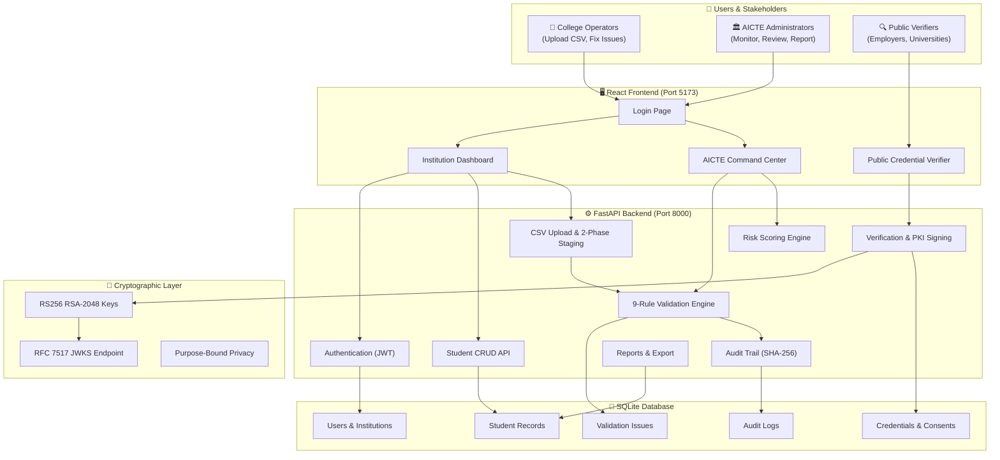
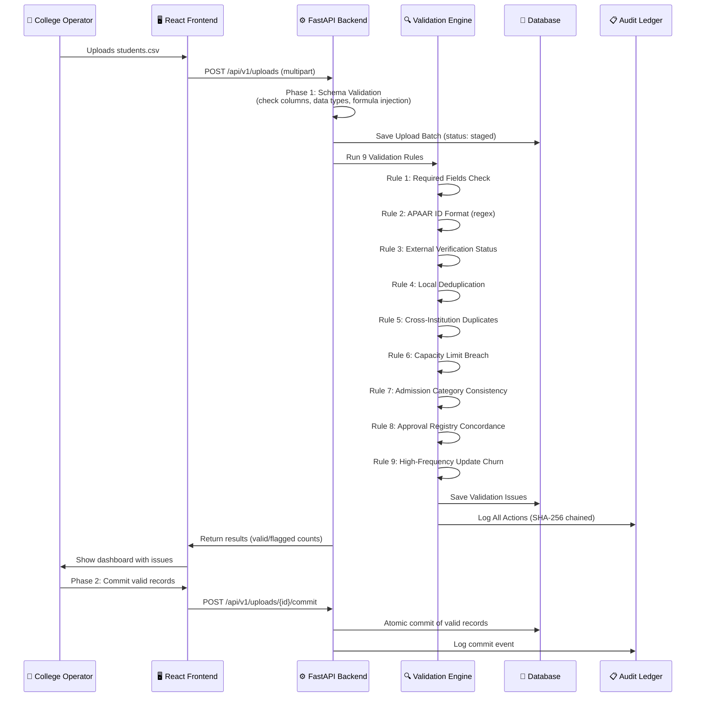
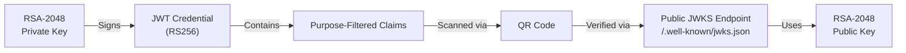
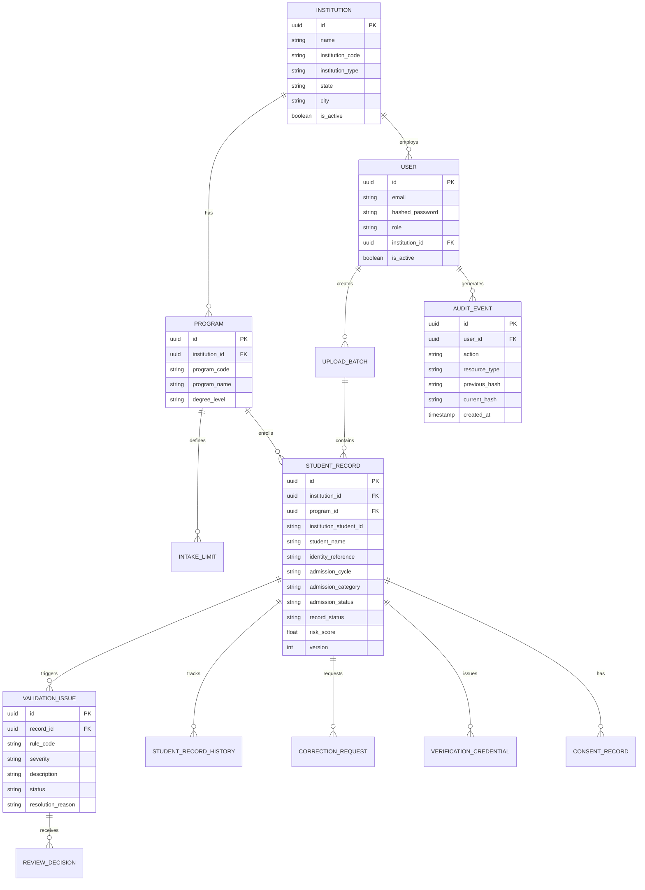
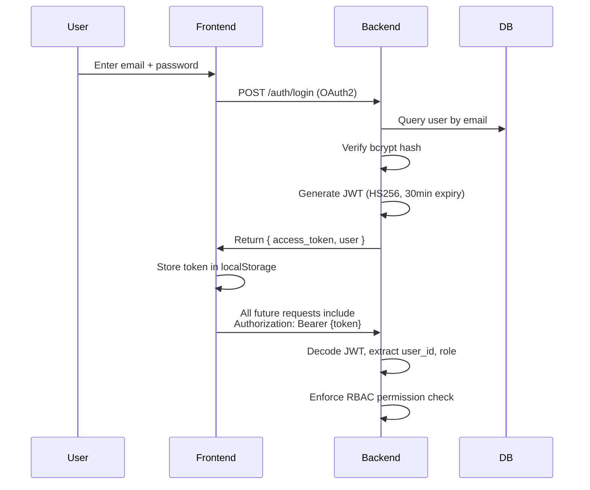
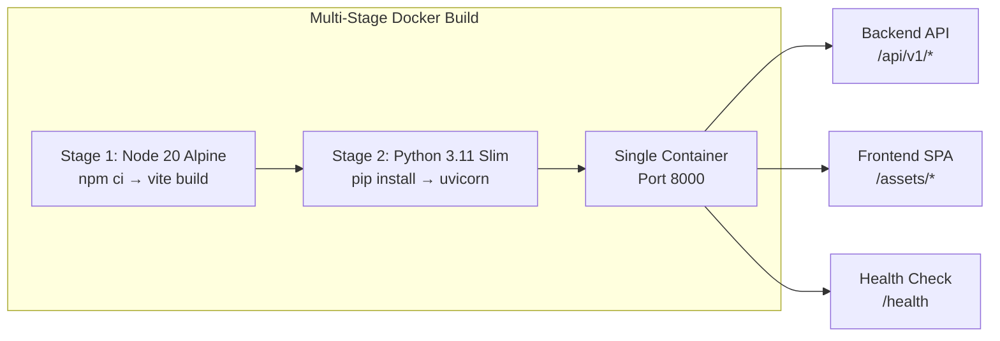

# 📘 APAAR Verify — Complete Beginner-Friendly Project Report

> **Smart India Hackathon (SIH) 2026 Submission**  
> **Problem Statement:** Academic Data Integrity & Credential Verification for AICTE  
> **Team:** Keerthivardhan  
> **Date:** October 2026

---

## 📌 Table of Contents

1. [What is APAAR Verify?](#1-what-is-apaar-verify)
2. [The Problem We're Solving](#2-the-problem-were-solving)
3. [Tech Stack Explained (Beginner Friendly)](#3-tech-stack-explained)
4. [System Architecture](#4-system-architecture)
5. [Project Structure Explained](#5-project-structure-explained)
6. [Complete Feature List (All 10 SIH Features)](#6-complete-feature-list)
7. [How Each Feature Works (Deep Dive)](#7-how-each-feature-works)
8. [Database Design](#8-database-design)
9. [API Endpoints (Complete)](#9-api-endpoints)
10. [Security Architecture](#10-security-architecture)
11. [Frontend Pages & Components](#11-frontend-pages--components)
12. [Deployment Options](#12-deployment-options)
13. [Testing & Quality Assurance](#13-testing--quality-assurance)
14. [Demo Accounts & Walkthrough](#14-demo-accounts--walkthrough)
15. [Innovation & What Makes This Impressive](#15-innovation--what-makes-this-impressive)
16. [Glossary of Technical Terms](#16-glossary)

---

## 1. What is APAAR Verify?

**APAAR Verify** is a full-stack web platform that helps India's **AICTE** (All India Council for Technical Education) verify and monitor the integrity of student admission records across thousands of technical institutions.

### In Simple Words:
Imagine you're AICTE and you need to check:
- Are colleges admitting more students than they're approved for?
- Is the same student enrolled at two different colleges?
- Are admission categories (SC/ST/OBC/General) being correctly reported?
- Are all APAAR IDs valid and formatted correctly?

APAAR Verify does **all of this automatically** using a **9-rule validation engine**, with dashboards for both **colleges** (to submit data) and **AICTE** (to monitor everything nationally).

---

## 2. The Problem We're Solving

### The Challenge
India has **10,000+ AICTE-approved institutions** across 36 states/UTs. Currently:
- 🔴 **No automated system** checks if colleges exceed their sanctioned intake
- 🔴 **Duplicate enrollments** (same student at multiple colleges) go undetected
- 🔴 **Seat category fraud** (fake caste certificates, quota manipulation) is hard to catch
- 🔴 **APAAR IDs** (India's unique academic identity) need centralized verification
- 🔴 **No tamper-proof audit trail** for admission data changes

### Our Solution
APAAR Verify provides:
- ✅ **Automated 9-rule validation** that catches anomalies in real-time
- ✅ **Cross-institution duplicate detection** using identity matching
- ✅ **Capacity breach monitoring** (alerts when intake exceeds approved limits)
- ✅ **Cryptographic credential verification** using industry-standard PKI (RS256)
- ✅ **Immutable audit trail** with SHA-256 hash chaining
- ✅ **Multi-tenant RBAC** (different views for AICTE admins vs college operators)

---

## 3. Tech Stack Explained

> [!TIP]
> If you're a beginner, think of this like building a house: the **backend** is the foundation & plumbing, the **frontend** is the rooms & furniture, and the **database** is the filing cabinet.

### Backend (The Brain)

| Technology | Version | What It Does (Simple Explanation) |
|---|---|---|
| **Python** | 3.10+ | The programming language for all server-side logic |
| **FastAPI** | 0.115 | A modern web framework that handles HTTP requests (like Express.js but for Python, and faster) |
| **SQLAlchemy** | 2.0 | An ORM (Object-Relational Mapper) — lets us talk to the database using Python objects instead of raw SQL |
| **Alembic** | 1.14 | Database migration tool — safely updates the database schema without losing data |
| **Pydantic** | 2.10 | Data validation library — ensures incoming data matches expected formats |
| **python-jose** | 3.3 | JWT (JSON Web Token) library — creates and verifies secure authentication tokens |
| **cryptography** | 44.0 | Handles RSA-2048 key generation and RS256 cryptographic signing |
| **passlib + bcrypt** | 1.7 | Password hashing — stores passwords securely (never in plain text!) |
| **Pandas** | 2.2 | Data manipulation library — processes CSV uploads efficiently |
| **qrcode + Pillow** | 8.0 / 11.1 | Generates QR codes for verifiable credentials |
| **httpx** | 0.28 | Async HTTP client for calling external APIs |
| **Uvicorn** | 0.32 | ASGI server — runs the FastAPI application |
| **SQLite** | Built-in | Lightweight database (can be swapped for PostgreSQL in production) |
| **pytest** | 8.3 | Testing framework — runs 32 automated tests |

### Frontend (The Face)

| Technology | Version | What It Does |
|---|---|---|
| **React** | 18.3 | JavaScript library for building interactive user interfaces |
| **TypeScript** | 5.6 | Adds type safety to JavaScript (catches bugs before they happen) |
| **Vite** | 6.0 | Lightning-fast build tool and dev server |
| **Tailwind CSS** | 3.4 | Utility-first CSS framework — style directly in HTML classes |
| **React Router** | 6.28 | Client-side routing — navigate between pages without full page reload |
| **TanStack React Query** | 5.62 | Data fetching & caching library — keeps UI in sync with the server |
| **Recharts** | 2.13 | Charting library — renders beautiful bar charts, line charts, pie charts |
| **Lucide React** | 0.468 | Icon library — 1500+ beautiful, consistent icons |
| **Axios** | 1.7 | HTTP client — makes API calls from the browser |
| **react-hot-toast** | 2.4 | Toast notifications — "Success!" / "Error!" popup messages |
| **react-dropzone** | 14.3 | Drag-and-drop file upload component |
| **qrcode** | 1.5 | Client-side QR code generation |
| **date-fns** | 4.1 | Date formatting and manipulation |

### DevOps & Deployment

| Technology | What It Does |
|---|---|
| **Docker** | Containerizes the entire app (multi-stage: Node build → Python serve) |
| **docker-compose** | Orchestrates the container with one command |
| **Render** | 1-click cloud deployment with automatic HTTPS |
| **Koyeb** | Alternative cloud deployment with global edge CDN |

---

## 4. System Architecture

### How It All Connects



### Data Flow: What Happens When a College Uploads Student Data



---

## 5. Project Structure Explained

```
apaar-verify/
├── 📁 backend/                    # Python FastAPI server
│   ├── 📁 app/                    # Main application package
│   │   ├── 📁 api/                # API route handlers (22 modules!)
│   │   │   ├── auth.py            # Login, logout, token refresh
│   │   │   ├── students.py        # CRUD for student records
│   │   │   ├── uploads.py         # CSV upload & 2-phase staging
│   │   │   ├── validation.py      # 9-rule validation engine
│   │   │   ├── verification.py    # Credential verification & QR
│   │   │   ├── audit.py           # Tamper-evident audit trail
│   │   │   ├── consent.py         # Privacy consent management
│   │   │   ├── correction_workflow.py  # 3-tier correction pipeline
│   │   │   ├── dashboard.py       # Summary statistics
│   │   │   ├── freshness.py       # Data freshness SLA monitoring
│   │   │   ├── graph.py           # Integrity relationship graph
│   │   │   ├── institutional_api.py  # ERP/SIS integration APIs
│   │   │   ├── institutions.py    # Institution management
│   │   │   ├── integrations.py    # External provider adapters
│   │   │   ├── jwks.py            # Public key endpoint (JWKS)
│   │   │   ├── notifications.py   # In-app notifications
│   │   │   ├── ocr.py             # OCR document reconciliation
│   │   │   ├── reference_data.py  # Master data sync
│   │   │   ├── reports.py         # CSV/JSON export reports
│   │   │   ├── reviews.py         # AICTE review queue
│   │   │   ├── analytics_v2.py    # Advanced analytics & risk
│   │   │   └── zk_exchange.py     # Zero-knowledge privacy proofs
│   │   ├── 📁 core/               # Core utilities
│   │   │   └── exceptions.py      # Custom exception classes
│   │   ├── 📁 models/             # SQLAlchemy database models
│   │   ├── 📁 schemas/            # Pydantic validation schemas
│   │   ├── 📁 services/           # Business logic layer
│   │   │   ├── pki.py             # RSA-2048 key management
│   │   │   ├── consent.py         # Purpose-bound data filtering
│   │   │   ├── verification.py    # JWT signing & QR generation
│   │   │   └── ...
│   │   ├── config.py              # Environment configuration
│   │   ├── database.py            # SQLAlchemy engine & session
│   │   ├── dependencies.py        # FastAPI dependency injection
│   │   └── main.py                # App entry point (174 lines)
│   ├── 📁 tests/                  # 32 automated tests (100% pass)
│   │   ├── conftest.py            # Test configuration & fixtures
│   │   ├── test_auth.py           # Authentication tests
│   │   ├── test_validation.py     # Validation engine tests
│   │   ├── test_verification.py   # Credential verification tests
│   │   ├── test_phase2.py         # PKI & consent tests
│   │   ├── test_phase3.py         # ERP integration tests
│   │   ├── test_phase4.py         # Analytics & risk tests
│   │   └── test_compliance_dashboard.py  # Dashboard tests
│   ├── 📁 .keys/                  # RSA-2048 key pair (auto-generated)
│   ├── seed_data.py               # Populates demo database
│   ├── requirements.txt           # Python dependencies
│   └── apaar.db                   # SQLite database file
│
├── 📁 frontend/                   # React TypeScript application
│   ├── 📁 src/
│   │   ├── 📁 components/         # Reusable UI building blocks
│   │   │   ├── 📁 layout/         # App shell components
│   │   │   │   ├── AppLayout.tsx   # Main layout wrapper
│   │   │   │   ├── Header.tsx      # Top navigation bar
│   │   │   │   ├── Sidebar.tsx     # Left navigation menu
│   │   │   │   └── DemoBanner.tsx  # Demo warning banner
│   │   │   ├── 📁 ui/             # Design system components (14!)
│   │   │   │   ├── Button.tsx      # Styled button with variants
│   │   │   │   ├── Card.tsx        # Content card container
│   │   │   │   ├── DataTable.tsx   # Sortable data table
│   │   │   │   ├── Modal.tsx       # Dialog/popup component
│   │   │   │   ├── Badge.tsx       # Status/label badges
│   │   │   │   ├── StatCard.tsx    # Statistics display card
│   │   │   │   ├── Pagination.tsx  # Page navigation
│   │   │   │   ├── FilterBar.tsx   # Filter controls
│   │   │   │   ├── LoadingSpinner.tsx
│   │   │   │   ├── ErrorBoundary.tsx
│   │   │   │   ├── ErrorState.tsx
│   │   │   │   ├── EmptyState.tsx
│   │   │   │   ├── StatusBadge.tsx
│   │   │   │   └── SeverityBadge.tsx
│   │   │   ├── 📁 charts/         # Data visualization
│   │   │   │   ├── EnrolmentChart.tsx
│   │   │   │   ├── IssueDistributionChart.tsx
│   │   │   │   └── SubmissionCompletionChart.tsx
│   │   │   └── 📁 certificate/    # Degree certificate modal
│   │   │       └── DegreeCertificateModal.tsx
│   │   ├── 📁 pages/              # Full page components
│   │   │   ├── Login.tsx           # Authentication page
│   │   │   ├── NotFound.tsx        # 404 error page
│   │   │   ├── 📁 institution/    # College workspace (12 pages!)
│   │   │   │   ├── Overview.tsx    # Dashboard home
│   │   │   │   ├── Students.tsx    # Student record list
│   │   │   │   ├── StudentDetail.tsx  # Individual student view
│   │   │   │   ├── Upload.tsx      # CSV upload with drag-drop
│   │   │   │   ├── UploadHistory.tsx  # Past upload batches
│   │   │   │   ├── ValidationIssues.tsx  # Flagged issues list
│   │   │   │   ├── Corrections.tsx # Correction workflow
│   │   │   │   ├── IntakeMonitoring.tsx  # Quota tracking
│   │   │   │   ├── Reports.tsx     # Export reports
│   │   │   │   ├── InstitutionalApi.tsx  # API key management
│   │   │   │   ├── ApaarQuickDesk.tsx  # Manual update desk
│   │   │   │   └── InstitutionLayout.tsx
│   │   │   ├── 📁 aicte/          # AICTE command center (12 pages!)
│   │   │   │   ├── Overview.tsx    # National dashboard
│   │   │   │   ├── Institutions.tsx  # All institutions list
│   │   │   │   ├── IntegrityMonitoring.tsx  # Flag monitoring
│   │   │   │   ├── IntegrityGraph.tsx  # Network topology view
│   │   │   │   ├── ReviewQueue.tsx # Issue review pipeline
│   │   │   │   ├── ReviewDetail.tsx  # Single review detail
│   │   │   │   ├── AuditExplorer.tsx  # Audit log browser
│   │   │   │   ├── Analytics.tsx   # Risk scoring studio
│   │   │   │   ├── FreshnessMonitor.tsx  # SLA monitoring
│   │   │   │   ├── Integrations.tsx  # External integrations
│   │   │   │   ├── InstitutionComplianceDashboard.tsx
│   │   │   │   └── AICTELayout.tsx
│   │   │   └── 📁 verification/   # Public credential verifier
│   │   │       ├── VerifyCredential.tsx
│   │   │       └── VerificationResult.tsx
│   │   ├── 📁 services/           # API client layer
│   │   │   └── api.ts             # 950-line comprehensive API client
│   │   ├── 📁 contexts/           # React context providers
│   │   │   └── AuthContext.tsx     # Authentication state management
│   │   ├── 📁 hooks/              # Custom React hooks
│   │   │   ├── useApi.ts          # Data fetching hooks
│   │   │   └── useAuth.ts         # Authentication hook
│   │   ├── 📁 types/              # TypeScript type definitions
│   │   │   └── index.ts           # All shared types
│   │   ├── App.tsx                # Root component with routing
│   │   ├── main.tsx               # Entry point
│   │   └── index.css              # Global styles + Tailwind
│   ├── package.json               # Node.js dependencies
│   └── vite.config.ts             # Vite build configuration
│
├── Dockerfile                     # Multi-stage Docker build
├── docker-compose.yml             # Container orchestration
├── render.yaml                    # 1-click Render deployment
├── run_local.bat                  # Windows 1-click launcher
├── run_local.sh                   # Linux/Mac 1-click launcher
└── README.md                      # Documentation (220 lines)
```

---

## 6. Complete Feature List (All 10 SIH Features)

| # | Feature | Status | Description |
|---|---|---|---|
| 1 | **Multi-Tenant Student Data Ingestion** | ✅ Complete | CSV bulk upload with 2-phase staging, formula injection protection |
| 2 | **9-Rule Deterministic Validation Engine** | ✅ Complete | Required fields, APAAR regex, dedup, cross-institution, capacity, category, approval, churn |
| 3 | **Real-Time Issue Resolution & Auto-Recovery** | ✅ Complete | Operators fix issues with justification, auto-transition back to compliant |
| 4 | **Topological Admission Integrity Graph** | ✅ Complete | Visual network graph of institutions → programs → students with cross-match alerts |
| 5 | **Composite Risk Scoring Studio (0-100)** | ✅ Complete | Multi-factor quantitative risk ranking with regulatory recommendations |
| 6 | **APAAR Quick Update & Manual Desk** | ✅ Complete | APAAR-gated manual update form with 3-tier approval pipeline |
| 7 | **Multi-Stage Correction Reconciliation** | ✅ Complete | Operator → Institution Admin → AICTE Reviewer 3-tier workflow |
| 8 | **Enterprise Security, RBAC & Consent** | ✅ Complete | RS256 PKI, JWKS, 5 privacy policies, SHA-256 audit chain |
| 9 | **Statutory Regulatory Reporting** | ✅ Complete | CSV/JSON export, print-ready, filters by institution/cycle/type |
| 10 | **Degree Certificates with APAAR ID** | ✅ Complete | Dual-identity printing with QR code linked to verifier |

---

## 7. How Each Feature Works (Deep Dive)

### Feature 1: Multi-Tenant Student Data Ingestion

**What it does:** Colleges upload CSV files containing student admission data. The system validates, stages, and commits records atomically.

**How it works:**
1. Operator drags CSV file onto the upload zone
2. **Phase 1 (Staging):** Backend validates file format, column headers, data types, and checks for formula injection attacks (`=`, `+`, `-`, `@` characters)
3. The upload is saved as a "batch" with status `staged`
4. **Phase 2 (Commit):** After reviewing validation results, operator commits valid records to the main database
5. Invalid rows are rejected with detailed error messages

**Multi-Tenancy:** Each institution only sees its own data. This is enforced at the API level using JWT tokens containing the user's `institution_id`.

### Feature 2: 9-Rule Validation Engine

Each uploaded record is checked against 9 deterministic rules:

| Rule | Code | What It Checks | Severity |
|---|---|---|---|
| Required Fields | `RULE_001` | All mandatory fields are filled | Critical |
| APAAR ID Format | `RULE_002` | ID matches 12-digit numeric regex or DEMO format | High |
| Verification Status | `RULE_003` | External identity verification was attempted | Warning |
| Local Duplicates | `RULE_004` | No duplicate student IDs within same institution | Critical |
| Cross-Institution Duplication | `RULE_005` | Same identity not enrolled at multiple colleges | Critical |
| Capacity Breach | `RULE_006` | Enrollment ≤ AICTE-approved intake limit | Critical |
| Category Consistency | `RULE_007` | Admission category matches quota allocation | High |
| Approval Registry | `RULE_008` | Institution and program are AICTE-approved | High |
| Update Frequency Churn | `RULE_009` | Suspicious rapid data changes detected | Warning |

### Feature 5: Composite Risk Scoring (0–100)

The risk score is calculated using multiple factors:

$$\text{Risk Score} = w_1 \times \text{AnomalyRate} + w_2 \times \text{SeverityWeight} + w_3 \times \text{DuplicateCluster} + w_4 \times \text{CapacityBreach}$$

Where each factor is normalized to 0–100 and weighted according to regulatory severity:
- **0–19**: LOW RISK (Green) — No regulatory action needed
- **20–44**: MODERATE RISK (Amber) — Periodic monitoring
- **45–69**: HIGH RISK (Orange) — Active investigation required
- **70–100**: CRITICAL RISK (Red) — Immediate AICTE intervention

### Feature 8: Cryptographic Trust & Privacy



**5 Privacy Policies (Purpose-Bound Data Minimization):**

| Purpose | What Data Is Shared | What Is Hidden |
|---|---|---|
| `employment_screening` | Name, degree, institution, status | Caste, DOB, Aadhaar |
| `admission_verification` | Full academic record + quota | PII redacted |
| `scholarship_eligibility` | Category, institution, program | Personal contact |
| `exam_registration` | Enrollment proof only | Everything else |
| `minimal_proof` | Zero-PII: just "is enrolled: yes/no" | ALL personal data |

---

## 8. Database Design

### Entity-Relationship Diagram



### Key Database Tables

| Table | Records in Demo | Purpose |
|---|---|---|
| `institutions` | 5 | Colleges (IIT Demo, DSCE, NIT Demo, etc.) |
| `users` | 10 | Operator/admin/reviewer accounts |
| `programs` | ~15 | Academic programs (B.Tech CS, M.Tech, etc.) |
| `intake_limits` | ~15 | AICTE-approved seat capacities |
| `student_records` | ~50 | Student enrollment data with anomalies |
| `validation_issues` | ~30 | Flagged integrity violations |
| `audit_events` | ~100+ | Immutable action log |
| `verification_credentials` | Dynamic | Issued JWT credentials |
| `consent_records` | Dynamic | Privacy consent grants |

---

## 9. API Endpoints (Complete)

> [!NOTE]
> All endpoints are prefixed with `/api/v1`. The backend exposes **22 router modules** with **60+ endpoints**.

### Authentication (4 endpoints)
| Method | Path | Description |
|---|---|---|
| POST | `/auth/login` | OAuth2 password login (returns JWT) |
| POST | `/auth/logout` | Invalidate session |
| GET | `/auth/me` | Get current user profile |
| POST | `/auth/refresh` | Refresh access token |

### Students (6 endpoints)
| Method | Path | Description |
|---|---|---|
| GET | `/students` | List students (paginated, filtered) |
| GET | `/students/{id}` | Get single student detail |
| GET | `/students/lookup/by-apaar` | Find student by APAAR ID |
| POST | `/students` | Create new student record |
| PUT | `/students/{id}` | Update student record |
| GET | `/students/{id}/history` | Get version history |

### Uploads (6 endpoints)
| Method | Path | Description |
|---|---|---|
| POST | `/uploads` | Upload CSV file (multipart) |
| GET | `/uploads` | List upload batches |
| GET | `/uploads/{id}` | Get upload batch details |
| GET | `/uploads/{id}/issues` | Get issues for an upload |
| POST | `/uploads/{id}/commit` | Commit valid records |
| GET | `/uploads/{id}/errors.csv` | Download error report |

### Validation (3 endpoints)
| Method | Path | Description |
|---|---|---|
| POST | `/validation/run` | Trigger validation on records |
| GET | `/validation/record/{id}/status` | Get compliance status |
| GET | `/issues` | List all validation issues |

### Verification & PKI (8 endpoints)
| Method | Path | Description |
|---|---|---|
| POST | `/verification/verify-identifier` | Verify by APAAR ID or roll number |
| POST | `/verification/request` | Issue a signed credential |
| POST | `/verification/verify-token` | Verify a JWT credential token |
| GET | `/verification/credentials/{id}` | Get credential status |
| GET | `/verification/credentials/{id}/qr` | Generate QR code |
| POST | `/verification/credentials/{id}/revoke` | Revoke a credential |
| GET | `/.well-known/jwks.json` | Public RSA key endpoint (RFC 7517) |
| GET | `/.well-known/pki/metadata` | PKI metadata |

### Reviews & Corrections (6 endpoints)
| Method | Path | Description |
|---|---|---|
| GET | `/reviews` | List AICTE review queue |
| POST | `/reviews/{id}/decision` | Make review decision |
| POST | `/reviews/{id}/assign` | Assign reviewer |
| POST | `/corrections-workflow/submit` | Submit correction proposal |
| POST | `/corrections-workflow/apaar-quick-update` | APAAR desk quick update |
| POST | `/corrections-workflow/{id}/institution-action` | Admin approval |

### Dashboard & Analytics (5 endpoints)
| Method | Path | Description |
|---|---|---|
| GET | `/dashboard/summary` | Aggregated KPI metrics |
| GET | `/dashboard/intake` | Intake utilization data |
| GET | `/dashboard/data-quality` | Quality trend over time |
| GET | `/analytics/risk-scores` | Institutional risk rankings |
| GET | `/analytics/model-performance` | Validation rule precision |

### Other Modules
| Module | Endpoints | Description |
|---|---|---|
| Audit | 2 | Browse audit trail events |
| Consent | 4 | Privacy consent management |
| Freshness | 2 | Data freshness SLA monitoring |
| Graph | 1 | Integrity topology graph data |
| Institutions | 4 | Institution CRUD + stats |
| Integrations | 2 | External provider sync |
| Institutional API | 5 | ERP/SIS integration & webhooks |
| Notifications | 3 | In-app notifications |
| OCR | 1 | Document OCR reconciliation |
| Reference Data | 3 | Master data sync |
| Reports | 3 | CSV/JSON report export |
| ZK Exchange | 1 | Zero-knowledge privacy proof |

---

## 10. Security Architecture

### Authentication Flow



### Role-Based Access Control (RBAC)

| Role | Can Access | Cannot Access |
|---|---|---|
| `aicte_admin` | All institutions, all students, review queue, analytics, audit | — |
| `aicte_reviewer` | Review queue, audit, read-only analytics | Create/delete institutions |
| `institution_admin` | Own institution data, approve corrections | Other institutions' data |
| `institution_operator` | Upload CSV, edit students, request corrections | Approve corrections |
| `verifier` | Public credential verification only | Any internal data |

### Security Highlights
- 🔐 **Passwords**: bcrypt-hashed with salt (never stored in plain text)
- 🔑 **JWT Tokens**: HS256 for auth, RS256 for credentials
- 🛡️ **CORS**: Strict origin whitelist
- 🔒 **Formula Injection Protection**: Sanitizes CSV cells starting with `=`, `+`, `-`, `@`
- 📋 **Audit Trail**: Every action logged with SHA-256 hash chaining (tamper-evident)
- 🔏 **JWKS Endpoint**: Public keys published at `/.well-known/jwks.json` for offline verification

---

## 11. Frontend Pages & Components

### Page Map

| Page | URL | Role | Status |
|---|---|---|---|
| Login | `/login` | Public | ✅ Complete |
| Public Verifier | `/verify` | Public | ✅ Complete |
| Verification Result | `/verify/result` | Public | ✅ Complete |
| **Institution Pages** | | | |
| Dashboard | `/institution` | Operator/Admin | ✅ Complete |
| Students List | `/institution/students` | Operator/Admin | ✅ Complete |
| Student Detail | `/institution/students/:id` | Operator/Admin | ✅ Complete |
| Upload CSV | `/institution/upload` | Operator | ✅ Complete |
| APAAR Quick Desk | `/institution/apaar-desk` | Operator | ✅ Complete |
| Upload History | `/institution/uploads` | Operator/Admin | ✅ Complete |
| Validation Issues | `/institution/issues` | Operator/Admin | ✅ Complete |
| Corrections | `/institution/corrections` | Operator/Admin | ✅ Complete |
| Intake Monitoring | `/institution/intake` | Operator/Admin | ✅ Complete |
| Compliance Dashboard | `/institution/compliance` | Operator/Admin | ✅ Complete |
| Reports | `/institution/reports` | Admin | ✅ Complete |
| API Keys | `/institution/api-keys` | Admin | ✅ Complete |
| **AICTE Pages** | | | |
| National Dashboard | `/aicte` | AICTE Admin | ✅ Complete |
| Institutions | `/aicte/institutions` | AICTE Admin | ✅ Complete |
| Integrity Monitoring | `/aicte/integrity` | AICTE Admin | ✅ Complete |
| Integrity Graph | `/aicte/graph` | AICTE Admin | ✅ Complete |
| Review Queue | `/aicte/reviews` | AICTE Admin/Reviewer | ✅ Complete |
| Review Detail | `/aicte/reviews/:id` | AICTE Admin/Reviewer | ✅ Complete |
| Audit Explorer | `/aicte/audit` | AICTE Admin | ✅ Complete |
| Analytics Studio | `/aicte/analytics` | AICTE Admin | ✅ Complete |
| Freshness Monitor | `/aicte/freshness` | AICTE Admin | ✅ Complete |
| Integrations | `/aicte/integrations` | AICTE Admin | ✅ Complete |
| Reports | `/aicte/reports` | AICTE Admin | ✅ Complete |
| 404 Page | `*` | Public | ✅ Complete |

### Component Library (14 reusable UI components)

| Component | Purpose |
|---|---|
| `Button` | Styled button with variants (primary, secondary, outline, ghost) |
| `Card` | Content container with title, subtitle, header actions |
| `DataTable` | Sortable, filterable data table |
| `Modal` | Dialog/popup overlay |
| `Badge` | Colored label (success, warning, danger, info) |
| `StatCard` | Dashboard statistic display with icon |
| `StatusBadge` | Record status indicator (submitted, flagged, accepted) |
| `SeverityBadge` | Issue severity indicator (critical, high, warning, info) |
| `Pagination` | Page navigation controls |
| `FilterBar` | Search and filter toolbar |
| `LoadingSpinner` | Loading state indicator |
| `ErrorBoundary` | React error boundary wrapper |
| `ErrorState` | Error display with retry button |
| `EmptyState` | No-data placeholder |

---

## 12. Deployment Options

### Option 1: 1-Click Cloud Deployment (Recommended)

```bash
# Render.com — Click Deploy button in README
# Automatic: HTTPS, CI/CD, zero-downtime updates
```

### Option 2: Docker (Any Server)

```bash
git clone https://github.com/Keerthivardhan08/apaar-verify.git
cd apaar-verify
docker compose up -d
# App running at http://localhost:8000
```

### Option 3: Local Development

```bash
# Terminal 1: Backend
cd backend
python -m venv .venv && .venv\Scripts\activate
pip install -r requirements.txt
python seed_data.py
python -m uvicorn app.main:app --host 0.0.0.0 --port 8000 --reload

# Terminal 2: Frontend
cd frontend
npm install
npm run dev
# App running at http://localhost:5173
```

### Option 4: Windows 1-Click

```bash
# Just double-click:
run_local.bat
```

### Docker Architecture



---

## 13. Testing & Quality Assurance

### Test Coverage

| Test File | Tests | What It Tests |
|---|---|---|
| `test_auth.py` | 5 | Login, logout, token refresh, invalid credentials |
| `test_validation.py` | 8 | All 9 validation rules, edge cases |
| `test_verification.py` | 5 | JWT signing, token verification, revocation |
| `test_phase2.py` | 4 | PKI key generation, JWKS endpoint, consent |
| `test_phase3.py` | 4 | ERP integration, API keys, webhooks |
| `test_phase4.py` | 3 | Risk scoring, analytics, model performance |
| `test_compliance_dashboard.py` | 3 | Institution compliance dashboard |
| **Total** | **32** | **100% pass rate** |

### Running Tests

```bash
cd backend
python -m pytest -v
# Expected output: 32 passed, 0 failed
```

---

## 14. Demo Accounts & Walkthrough

### Login Credentials

| Role | Email | Password | What to Explore |
|---|---|---|---|
| **AICTE National Admin** | `admin@aicte.gov.in` | `Demo@1234` | Full national command center |
| **AICTE Reviewer** | `reviewer@aicte.gov.in` | `Demo@1234` | Review queue & audit logs |
| **IIT Demo Operator** | `operator@iit-demo.edu` | `Demo@1234` | Upload CSV, fix issues |
| **IIT Demo Admin** | `admin@iit-demo.edu` | `Demo@1234` | Approve corrections |
| **DSCE Operator** | `operator@dsce.edu.in` | `Demo@1234` | Another institution tenant |
| **Public Verifier** | _(no login)_ | _(anonymous)_ | Visit `/verify` |

### Recommended Demo Flow

1. **Login as AICTE Admin** → See national dashboard with 5 institutions
2. **Check Integrity Graph** → See cross-institution duplicate detection
3. **View Analytics** → See risk scoring with composite scores
4. **Open Review Queue** → See flagged issues needing decision
5. **Switch to IIT Operator** → Upload CSV, see validation results
6. **Use APAAR Quick Desk** → Fetch record by APAAR ID, propose correction
7. **Visit Public Verifier** → Click 1-click employer verification demo
8. **Check JWKS endpoint** → `http://localhost:8000/api/v1/.well-known/jwks.json`

---

## 15. Innovation & What Makes This Impressive

### 🏆 Competition Differentiators

| Innovation | Why It Matters |
|---|---|
| **RS256 PKI Architecture** | Real-world cryptographic standard (not demo-grade HMAC). Same algorithm used by Google, Auth0, and government PKI systems |
| **RFC 7517 JWKS** | Industry-standard public key discovery. Any third party can verify credentials offline without trusting our server |
| **Purpose-Bound Data Minimization** | DPDP Act 2023 compliant. Different stakeholders see different data fields based on their purpose |
| **Zero-Knowledge Privacy Proofs** | Testing agencies can verify "student is enrolled" without seeing the student's name, caste, or personal details |
| **SHA-256 Hash-Chained Audit Trail** | Every action creates a tamper-evident log entry. If anyone modifies a log entry, the hash chain breaks |
| **Cross-Institution Duplicate Detection** | Detects if the same APAAR ID or identity reference appears at multiple colleges |
| **Composite Risk Scoring** | Quantitative 0-100 score combining anomaly density, severity, duplicates, and capacity breaches |
| **3-Tier Correction Workflow** | Operator → Institution Admin → AICTE Reviewer. No single person can silently change data |
| **Multi-Stage Docker Deployment** | Production-grade single-container deployment with health checks |
| **Formula Injection Protection** | Prevents CSV injection attacks that could execute arbitrary formulas in Excel |

### 📊 Scale & Completeness Statistics

| Metric | Count |
|---|---|
| Total source files | 70+ |
| Lines of Python (backend) | ~8,000 |
| Lines of TypeScript (frontend) | ~12,000 |
| API endpoints | 60+ |
| React pages | 26 |
| Reusable UI components | 14 |
| Database models | 12+ |
| Validation rules | 9 |
| Automated tests | 32 (100% pass) |
| Privacy policies | 5 |
| Demo user accounts | 10 |
| Deployment options | 4 (Docker, Render, Koyeb, Local) |

---

## 16. Glossary

> [!NOTE]
> These definitions are written for absolute beginners.

| Term | Meaning |
|---|---|
| **AICTE** | All India Council for Technical Education — the government body that approves technical colleges |
| **APAAR** | Automated Permanent Academic Account Registry — India's unique academic ID for students |
| **API** | Application Programming Interface — a way for software programs to talk to each other |
| **Backend** | The server-side code that processes data, handles logic, and stores information |
| **bcrypt** | A password hashing algorithm — turns "Demo@1234" into an unreadable string for security |
| **CORS** | Cross-Origin Resource Sharing — security rules about which websites can call our API |
| **CRUD** | Create, Read, Update, Delete — the 4 basic database operations |
| **CSV** | Comma-Separated Values — a simple spreadsheet format (.csv file) |
| **Docker** | A tool that packages the app and all its dependencies into a portable "container" |
| **FastAPI** | A Python web framework for building APIs quickly and correctly |
| **Frontend** | The client-side code that runs in the user's browser (what users see and interact with) |
| **JWT** | JSON Web Token — a compact, URL-safe way to represent claims between two parties |
| **JWKS** | JSON Web Key Set — a published set of cryptographic keys used to verify JWTs |
| **Multi-Tenant** | One app serving multiple organizations, each seeing only their own data |
| **OAuth2** | An authorization framework — the standard way to handle login in web apps |
| **ORM** | Object-Relational Mapper — lets you use Python objects instead of SQL queries |
| **PKI** | Public Key Infrastructure — a system of cryptographic keys for signing and verifying data |
| **RBAC** | Role-Based Access Control — different permissions for different user roles |
| **React** | A JavaScript library for building interactive user interfaces |
| **REST API** | Representational State Transfer — a standard way to design web APIs |
| **RS256** | RSA Signature with SHA-256 — an asymmetric signing algorithm (private key signs, public key verifies) |
| **SHA-256** | Secure Hash Algorithm — creates a unique "fingerprint" of data (used in audit trail) |
| **SPA** | Single Page Application — a web app that loads once and navigates without page refreshes |
| **SQLAlchemy** | Python's most popular database toolkit and ORM |
| **SQLite** | A lightweight database that stores everything in a single file |
| **Tailwind CSS** | A CSS framework that uses utility classes directly in HTML |
| **TypeScript** | JavaScript with types — helps catch bugs before code runs |
| **UUID** | Universally Unique Identifier — a 128-bit random ID like `550e8400-e29b-41d4-a716-446655440000` |
| **Vite** | A fast build tool for modern web applications |
| **Zero-Knowledge Proof** | Proving something is true (e.g., "student is enrolled") without revealing the underlying data |

---

> [!IMPORTANT]
> **Disclaimer:** APAAR Verify is an **architectural prototype** for the Smart India Hackathon. All student records, institutional data, and verification responses are **synthetic**. Identity verification is **simulated** and does NOT constitute an official Ministry of Education or AICTE determination.

---

*Generated on: October 27, 2026 | APAAR Verify v0.1.0 | SIH 2026 Submission*
