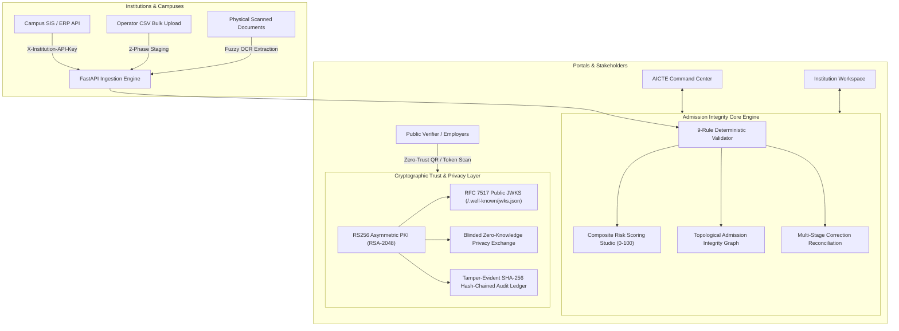

# APAAR Verify — Academic Data Integrity & Credential Verification Platform

[](https://python.org)
[](https://fastapi.tiangolo.com)
[](https://react.dev)
[](https://www.typescriptlang.org)
[]()
[-success.svg)]()

> **⚠️ DEMONSTRATION & PROTOTYPE NOTICE**  
> APAAR Verify is an architectural and engineering prototype designed for the Smart India Hackathon. All student records, institutional figures, and verification responses shown are synthetic. Identity queries are simulated and do **NOT** constitute an official Ministry of Education or AICTE determination.

---

## 1. System Architecture



---

## 2. Quick Start (1-Click Local Execution)

### Prerequisites
- **Python 3.10+** (with pip)
- **Node.js 18+** (with npm)
- **Git**

### 1-Click Launchers

#### On Windows:
Double-click `run_local.bat` or run:
```cmd
run_local.bat
```

#### On Linux / macOS:
```bash
chmod +x run_local.sh
./run_local.sh
```

The script automatically installs dependencies, creates and seeds the database with synthetic records, compiles the frontend bundle, and launches the unified server at **`http://localhost:8000`**.

---

## 3. Manual Step-by-Step Setup

If you prefer to start services independently:

### Step 1: Clone Repository
```bash
git clone https://github.com/Keerthivardhan08/apaar-verify
cd apaar-verify
```

### Step 2: Backend Setup
```bash
cd backend

# Create and activate virtual environment (optional but recommended)
python -m venv .venv
# Windows: .venv\Scripts\activate
# Linux/macOS: source .venv/bin/activate

# Install dependencies
pip install -r requirements.txt

# Seed synthetic database with institutions, intake limits, and 50 records with deliberate anomalies
python seed_data.py

# Launch FastAPI server
python -m uvicorn app.main:app --host 0.0.0.0 --port 8000 --reload
```
* Backend API & Docs: `http://localhost:8000/api/v1/docs`
* Health Check: `http://localhost:8000/health`
* Dynamic JWKS Endpoint: `http://localhost:8000/api/v1/.well-known/jwks.json`

### Step 3: Frontend Setup
In a new terminal window:
```bash
cd frontend

# Install Node dependencies
npm install

# Start Vite development server
npm run dev
```
* Web Application: `http://localhost:5173`
* Public Verifier: `http://localhost:5173/verify`

---

## 4. Default Demonstration Login Accounts

| Role | Email | Password | Primary Workflow |
|---|---|---|---|
| **AICTE Administrator** | `admin@aicte.gov.in` | `Demo@1234` | National command center, topological graph, risk studio, intake limits |
| **AICTE Reviewer** | `reviewer@aicte.gov.in` | `Demo@1234` | Investigate anomalies, review expanded corrections, audit logs |
| **IIT Demo Operator** | `operator@iit-demo.edu` | `Demo@1234` | Batch uploads, student records, interactive OCR reconciliation |
| **NIT Demo Operator** | `operator@nit-demo.edu` | `Demo@1234` | Isolated institutional tenant with independent student data |
| **Public Verifier** | Anonymous / Public | N/A | QR scanning and cryptographic token verification (`/verify`) |

---

## 5. Key Feature Highlights

### Phase 1: Reliable Data Integrity (MVP Core)
- **9 Deterministic Integrity Rules:** Required fields, APAAR ID syntax regex, external verification status, local deduplication, cross-institution duplicate syndicates, capacity limit breaches, admission category consistency, approval registry concordance, and high-frequency update churn.
- **Two-Phase CSV Staging Pipeline:** Format and schema validation prior to atomic database commitment, with formula injection protection (`=`, `+`, `-`, `@`).
- **Strict Role-Based Multi-Tenancy:** Institutional operators are cryptographically restricted to their own institution's data.
- **Topological Integrity Graph:** Interactive network graph connecting Institutions, Programs, Admission Cycles, and Student Records.

### Phase 2: Enterprise Cryptographic Trust
- **Asymmetric RS256 PKI:** RSA-2048 managed keypair signing verifiable credential tokens with `kid: apaar-rsa-2026-v1`.
- **RFC 7517 Dynamic JWKS:** Public key discovery endpoint at `GET /api/v1/.well-known/jwks.json` enabling offline, zero-trust third-party verification.
- **Purpose-Bound Data Minimization:** 5 scoped disclosure policies (`admission_verification`, `scholarship_eligibility`, `employment_screening`, `exam_registration`, `minimal_proof`).

### Phase 3: Integration & Reconciliation Network
- **Direct Campus ERP Ingestion:** Machine-to-machine batch push via `X-Institution-API-Key` headers with SHA-256 hashed key storage.
- **Authoritative Master Synchronization:** Intake capacity variance engine reconciling institutional submissions against official AICTE sanctioned ceilings.
- **30-Day Mandatory SLA Tracker:** Regulatory source freshness monitoring alerting on stale institutional data.
- **Expanded Correction Workflows:** Multi-tiered reconciliation (Operator &rarr; Inst Admin &rarr; AICTE Reviewer).
- **Zero-Knowledge Blinded Proofs:** Cryptographic assertions of student status without exposing personal identifiers.

### Phase 4: Advanced Integrity Analytics & OCR
- **Composite Risk Scoring Engine:** Quantitative institutional integrity index ($0\text{–}100$) categorized into Risk Tiers (`CRITICAL_RISK`, `HIGH_RISK`, `MODERATE_RISK`, `LOW_RISK`).
- **Ingestion Velocity & Forecasting:** 6-month historical time series and 30-day forward moving-average anomaly projection.
- **Model Performance Studio:** Decision concordance and precision metrics ($96\%+$ average precision) across all 9 validation rule engines.
- **OCR-Assisted Document Reconciliation:** Fuzzy field comparison (`difflib`) between scanned paper credentials (marksheets, diplomas) and database records, automatically generating `DOCUMENT_DATA_MISMATCH` compliance flags on conflict.

---

## 6. Running Automated Tests

Run the complete test suite across all 4 phases:
```bash
cd backend
python -m pytest -v
```
**Test Result: 31 of 31 tests passing (100% pass rate, 0 errors, 0 warnings).**

---

## 7. Walkthrough Documents

Step-by-step demonstration walkthrough guides covering all 7 interactive scenarios:
- **PDF Format:** [APAAR_Verify_Demo_Walkthrough.pdf](APAAR_Verify_Demo_Walkthrough.pdf)
- **Word Format:** [APAAR_Verify_Demo_Walkthrough.docx](APAAR_Verify_Demo_Walkthrough.docx)

---

## 8. License

This project is licensed under the Apache 2.0 License.
