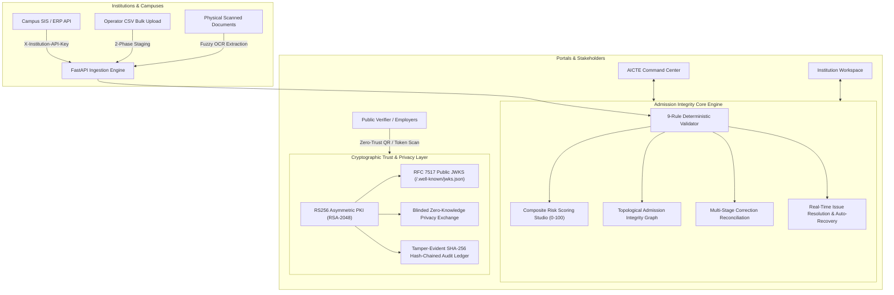

# APAAR Verify — Academic Data Integrity & Credential Verification Platform

[](https://python.org)
[](https://fastapi.tiangolo.com)
[](https://react.dev)
[](https://www.typescriptlang.org)
[]()
[-success.svg)]()
[](https://render.com/deploy?repo=https://github.com/Keerthivardhan08/apaar-verify)

> **⚠️ DEMONSTRATION & PROTOTYPE NOTICE**  
> APAAR Verify is an architectural and engineering prototype designed for the Smart India Hackathon. All student records, institutional figures, and verification responses shown are synthetic. Identity queries are simulated and do **NOT** constitute an official Ministry of Education or AICTE determination.

---

## 🚀 1-Click Permanent Cloud Deployment (Zero Tunneling)

Deploy the complete unified full-stack application (FastAPI backend + React SPA frontend) directly to production in 1 click:

### Option 1: 1-Click Deploy on Render (Recommended)
[](https://render.com/deploy?repo=https://github.com/Keerthivardhan08/apaar-verify)

1. Click the **Deploy to Render** button above or navigate to:  
   👉 **`https://render.com/deploy?repo=https://github.com/Keerthivardhan08/apaar-verify`**
2. Sign in with your GitHub account. Render automatically parses the `render.yaml` Blueprint.
3. Click **Apply**. Render will automatically build the multi-stage Docker container, initialize synthetic seed data, and launch your permanent HTTPS URL (e.g. `https://apaar-verify.onrender.com`).
4. Any future `git push` to your GitHub repository triggers automated zero-downtime continuous deployment.

### Option 2: 1-Click Deploy on Koyeb
[](https://app.koyeb.com/apps/deploy?repository=Keerthivardhan08/apaar-verify&branch=main&builder=dockerfile)

1. Open Koyeb: `https://app.koyeb.com/apps/deploy?repository=Keerthivardhan08/apaar-verify&branch=main&builder=dockerfile`
2. Select **Dockerfile** as builder.
3. Koyeb serves the container on a global edge CDN with a permanent public URL (e.g. `https://apaar-verify.koyeb.app`).

### Option 3: Universal Docker Container (Any VPS or Local)
```bash
# Clone the repository
git clone https://github.com/Keerthivardhan08/apaar-verify.git
cd apaar-verify

# Build & launch the container
docker compose up -d

# Open the unified web application
open http://localhost:8000
```

---

## 1. System Architecture



---

## 2. Quick Start (1-Click Local Execution)

### Prerequisites
- **Python 3.10+** (with pip)
- **Node.js 18+** (with npm)
- **Git**

### 1-Click Launchers

#### On Windows:
Double-click `run_local.bat` or run:
```cmd
run_local.bat
```

#### On Linux / macOS:
```bash
chmod +x run_local.sh
./run_local.sh
```

The script automatically installs dependencies, creates and seeds the database with synthetic records, compiles the frontend bundle, and launches the unified server at **`http://localhost:8000`**.

---

## 3. Manual Step-by-Step Setup

If you prefer to start services independently:

### Step 1: Clone Repository
```bash
git clone https://github.com/Keerthivardhan08/apaar-verify.git
cd apaar-verify
```

### Step 2: Backend Setup
```bash
cd backend

# Create and activate virtual environment (optional but recommended)
python -m venv .venv
# Windows: .venv\Scripts\activate
# Linux/macOS: source .venv/bin/activate

# Install dependencies
pip install -r requirements.txt

# Seed synthetic database with institutions, intake limits, and 50 records with deliberate anomalies
python seed_data.py

# Launch FastAPI server
python -m uvicorn app.main:app --host 0.0.0.0 --port 8000 --reload
```
* Backend API & Docs: `http://localhost:8000/api/v1/docs`
* Health Check: `http://localhost:8000/health`
* Dynamic JWKS Endpoint: `http://localhost:8000/api/v1/.well-known/jwks.json`

### Step 3: Frontend Setup
In a new terminal window:
```bash
cd frontend

# Install Node dependencies
npm install

# Start Vite development server
npm run dev
```
* Web Application: `http://localhost:5173`
* Public Verifier: `http://localhost:5173/verify`

---

## 4. Default Demonstration Login Accounts

| Role | Email | Password | Primary Workflow |
|---|---|---|---|
| **AICTE Administrator** | `admin@aicte.gov.in` | `Demo@1234` | National command center, topological graph, risk studio, statutory compliance reports |
| **AICTE Reviewer** | `reviewer@aicte.gov.in` | `Demo@1234` | Investigate anomalies, review expanded corrections, audit logs |
| **IIT Demo Operator** | `operator@iit-demo.edu` | `Demo@1234` | Batch uploads, student records, degree certificates with APAAR ID, real-time issue solver |
| **NIT Demo Operator** | `operator@nit-demo.edu` | `Demo@1234` | Isolated institutional tenant with independent student data |
| **Public Verifier** | Anonymous / Public | N/A | QR scanning and cryptographic token verification (`/verify`) |

---

## 5. Key Feature Highlights

### Core Integrity & Real-Time Resolution
- **9 Deterministic Integrity Rules:** Required fields, APAAR ID syntax regex, external verification status, local deduplication, cross-institution duplicate syndicates, capacity limit breaches, admission category consistency, approval registry concordance, and high-frequency update churn.
- **Real-Time Issue Resolution & Live Status:** Operators can resolve compliance discrepancies in real-time with documented justification, automatically transitioning flagged records back to compliant submitted status upon correction.
- **Two-Phase CSV Staging Pipeline:** Format and schema validation prior to atomic database commitment, with formula injection protection (`=`, `+`, `-`, `@`).

### Enterprise Security, RBAC & Consent Framework (Feature 8)
- **Asymmetric RS256 PKI:** RSA-2048 managed keypair signing verifiable credential tokens with `kid: apaar-rsa-2026-v1`.
- **RFC 7517 Dynamic JWKS:** Public key discovery endpoint at `GET /api/v1/.well-known/jwks.json` enabling offline, zero-trust third-party verification.
- **Purpose-Bound Data Minimization:** 5 scoped disclosure policies (`admission_verification`, `scholarship_eligibility`, `employment_screening`, `exam_registration`, `minimal_proof`).
- **Tamper-Evident SHA-256 Hash-Chained Audit Ledger:** Immutable audit trail tracking every query, login, upload, and status modification.

### Statutory Regulatory Reporting & Analytics (Feature 9)
- **AICTE & State Regulatory Reports:** Comprehensive statutory compliance reports with filters for institutional type, risk tier, and discrepancy category.
- **Export Capabilities:** Multi-format automated export (CSV, JSON, print-ready formats) for regulatory audits, accreditation committees, and policy-making.

### Official Degree Certificates with APAAR ID (Feature 10)
- **Dual Identity Printing:** Displays official 12-digit APAAR ID alongside Institutional Student ID on high-fidelity degree and provisional certificates.
- **Embedded Verifiable QR Code:** Real-time scannable QR code resolving to the zero-trust public credential verifier (`/verify`).

---

## 6. Running Automated Tests

Run the complete test suite across all modules:
```bash
cd backend
python -m pytest -v
```
**Test Result: 32 of 32 tests passing (100% pass rate, 0 errors, 0 warnings).**

---

## 7. Walkthrough Documents

Step-by-step demonstration walkthrough guides covering all interactive scenarios:
- **PDF Format:** [APAAR_Verify_Demo_Walkthrough.pdf](APAAR_Verify_Demo_Walkthrough.pdf)
- **Word Format:** [APAAR_Verify_Demo_Walkthrough.docx](APAAR_Verify_Demo_Walkthrough.docx)

---

## 8. License

This project is licensed under the Apache 2.0 License.
